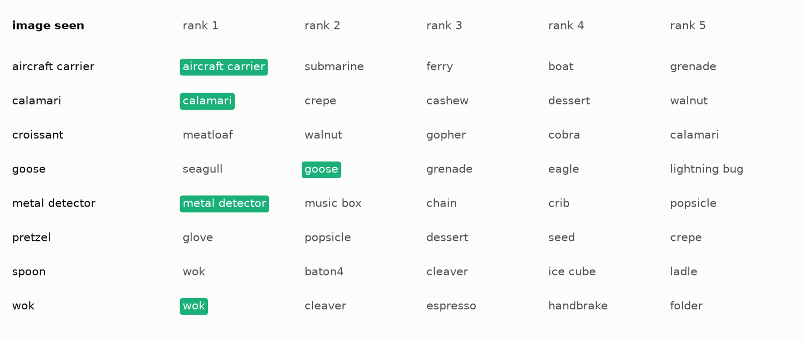
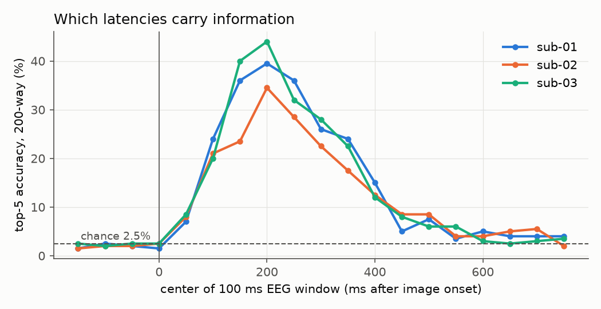
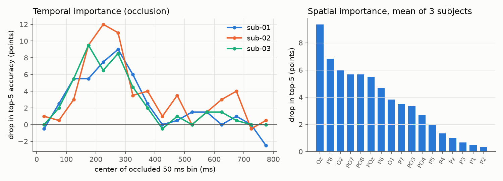

# eeg-to-image: which image was this person looking at?



This repo trains a small network to map 100 ms-resolution EEG from 17 posterior electrodes onto the CLIP embedding of the image a person was viewing. It then picks that image out of 200 images from concepts the model never saw during training. Across three subjects of the public THINGS-EEG2 dataset, the correct image is ranked first 25.2% of the time and in the top five 56.9% of the time, where chance is 0.5% and 2.5%.

<!-- TODO(Tommaso): your own words on why -->

The figure above shows concept names, not pictures, because the THINGS images may not be redistributed (see [Data and licenses](#data-and-licenses)). The rows are evenly spaced through the 200 test concepts, not hand-picked. To see the same figure with the actual images, run `python -m eeg2img.figures --images` after downloading the data; it writes `figures/local/retrieval_images_sub-01.png`, which is git-ignored.

## Usage

Python 3.10 or newer. On a Mac the training runs on the MPS GPU; elsewhere it runs on the CPU.

```bash
python3 -m venv .venv && source .venv/bin/activate
pip install -e ".[clip,test]"

# 1. Data: THINGS-EEG2 preprocessed EEG (about 1.07 GB per subject) and the image set (0.66 GB) from OSF
python -m eeg2img.data --images --subjects 1 2 3

# 2. CLIP ViT-B/32 image embeddings, computed once (about 6 minutes on an M-series Mac)
python -m eeg2img.embed

# 3. Train and evaluate one subject
python -m eeg2img.train --subject 1

# 4. Every experiment in this README (resumable; appends to results/runs.jsonl)
python -m eeg2img.experiments --subjects 1 2 3

# 5. Summary table and figures
python -m eeg2img.figures            # add --images for the local-only picture grid
pytest -q                            # synthetic tests, no downloads
```

Subjects are processed one at a time. EEG arrays are stored as float32 `.npy` files and opened memory-mapped. Before each training run the code checks `memory_pressure` and waits if free memory is under 25%.

## Results

Test set: 200 images, one per concept, none of whose concepts appear in training. Each test EEG response is the average of 80 repetitions. Numbers are mean ± standard deviation over 3 training seeds. One-sided binomial test of top-1 against chance for seed 0: p < 1e-60 for every subject.

| | sub-01 | sub-02 | sub-03 | mean |
|---|---|---|---|---|
| top-1, 200-way (chance 0.5%) | 25.3 ± 0.8 | 24.8 ± 1.5 | 25.5 ± 1.8 | 25.2 |
| top-5, 200-way (chance 2.5%) | 59.5 ± 2.4 | 55.8 ± 0.6 | 55.5 ± 1.4 | 56.9 |

Controls and baselines (top-1 / top-5, %):

| | sub-01 | sub-02 | sub-03 |
|---|---|---|---|
| shuffled EEG-image pairing during training (3 seeds) | 0.8 / 3.3 | 0.5 / 2.2 | 0.7 / 2.0 |
| ridge regression, EEG to CLIP (linear baseline) | 14.0 / 41.5 | 17.0 / 40.5 | 11.5 / 42.0 |
| occipital and parieto-occipital electrodes only (8) | 18.0 / 51.0 | 24.5 / 50.5 | 16.5 / 48.5 |
| parietal electrodes only (9) | 11.0 / 34.0 | 9.0 / 35.0 | 11.0 / 33.5 |

The shuffled control lands at chance, which is what should happen if the pipeline has no leak between EEG and test images. A linear map already gets well above chance; the convolutional encoder adds about 10 points of top-1. The 8 occipital and parieto-occipital channels (O1, Oz, O2, PO7, PO3, POz, PO4, PO8) carry most of the information.

Full table: [results/summary.md](results/summary.md). Raw per-run results: [results/runs.jsonl](results/runs.jsonl).

### Which latencies carry information



Each point is a separate model trained and tested on one 100 ms EEG window (one seed, at most 60 epochs). Windows that end before image onset are at chance, as they should be. Accuracy rises from the 0 to 100 ms window, peaks for the 150 to 250 ms window (top-5 of 39.5%, 34.5% and 44.0% for the three subjects), and falls back near chance after about 500 ms. A single 100 ms window around 200 ms gets about two thirds of the accuracy of the full 0 to 800 ms epoch.

### Temporal and spatial importance



For the full models (seed 0), each 50 ms bin or each electrode is replaced by its training mean on the test set and the drop in top-5 accuracy is measured. The temporal profile agrees with the window experiment: the 150 to 300 ms range matters most. Oz, P8, O2 and the PO electrodes matter most; midline and left parietal electrodes (P1, P2, P3) matter least. With 200 test images one image is 0.5 points, so single-electrode differences of one or two points are within noise.

### Comparison with published numbers

Song et al. (2024) report, for their NICE model on THINGS-EEG2 within-subject, top-1 / top-5 of 12.3 / 36.6 (sub-01), 10.4 / 33.9 (sub-02), 13.1 / 39.0 (sub-03), and 13.8 / 39.5 averaged over 10 subjects; their best variant (NICE-GA) averages 15.6 / 42.8. The numbers here are higher, but the setups differ in ways that matter, so this is not a like-for-like comparison:

- NICE uses all 63 channels resampled to 250 Hz from the raw data and a 0 to 1000 ms epoch; this repo uses the authors' 17-channel, 100 Hz preprocessed release and 0 to 800 ms.
- NICE aligns to CLIP ViT-L/14; this repo uses CLIP ViT-B/32.
- Here the 4 training repetitions of each image are averaged before training.

The ridge baseline in this repo, which has no deep network at all, is already in the range NICE reports. That suggests the data choice (preprocessed release, averaged training repetitions) accounts for a large part of the difference, and the architecture for less. NICE's code was not run on this exact setup, so which factor dominates is open.

## How it works

Data. THINGS-EEG2 (Gifford et al., 2022) has 10 subjects who each viewed 16,540 training images (1,654 concepts, 10 images each, 4 repetitions) and 200 test images (200 other concepts, 1 image each, 80 repetitions) in a rapid serial visual presentation. The authors' preprocessed release has 17 posterior channels at 100 Hz from -200 to 800 ms. Each channel and time point is z-scored with statistics from the training set only.

Targets. Every image is passed once through CLIP ViT-B/32 (OpenAI weights, via `open_clip`) and the 512-dimensional image embedding is L2-normalized. CLIP stays frozen.

Encoder. A temporal convolution (40 filters, 250 ms kernel), average pooling over time, a spatial convolution across all channels, then a linear projection with one residual block to 512 dimensions. About 0.4 M parameters.

Loss. For a batch of $B$ pairs of EEG trial $x_i$ and image embedding $v_i$, let $f$ be the EEG encoder and

$$
s_{ij} = \frac{f(x_i)^\top v_j}{\lVert f(x_i)\rVert \, \lVert v_j \rVert}.
$$

The symmetric InfoNCE loss with a learned temperature $\tau$ is

$$
\mathcal{L} = -\frac{1}{2B}\sum_{i=1}^{B}\left[
\log\frac{\exp(s_{ii}/\tau)}{\sum_{j=1}^{B}\exp(s_{ij}/\tau)}
+ \log\frac{\exp(s_{ii}/\tau)}{\sum_{j=1}^{B}\exp(s_{ji}/\tau)}
\right].
$$

Each EEG trial is pushed toward the embedding of its own image and away from the other $B-1$ images in the batch (batch size 1024), and the same holds in the image-to-EEG direction.

Retrieval. For a test EEG response $x$ and the 200 test image embeddings $v_1, \dots, v_{200}$, the prediction is

$$
\hat{c} = \arg\max_{j \in \{1,\dots,200\}} s\big(f(x), v_j\big),
$$

and a trial counts as top-$k$ correct if fewer than $k$ candidates score higher than the true image. Chance accuracy is $k/200$. The test concepts are never seen in training, so the model has to rely on the structure of the CLIP space to generalize ("zero-shot").

Model selection. 74 training concepts (740 images) are held out as a validation set, and the epoch with the best validation top-5 is kept (AdamW, learning rate 3e-4, weight decay 0.01, at most 150 epochs, patience 20). The test set is used only for the reported numbers. One caveat: the epoch budget was raised from 100 to 150 after a single pilot run on sub-01 whose test accuracy was looked at.

Image generation. The last step of many EEG-to-image papers turns the predicted embedding into a picture with a diffusion model. Common pretrained unCLIP models condition on CLIP ViT-L/14 or ViT-H/14 embeddings, not ViT-B/32, and would need several GB of memory alongside other jobs on the same laptop. This step was skipped. The figures show the nearest real test images instead, which is closer to what the EEG supports.

## Limitations

- This is retrieval among 200 known candidates, not reconstruction and not mind reading. The model picks the closest of 200 images it is shown; it cannot say what someone sees outside such a set, and it needs averaged EEG from a cooperating viewer.
- Test responses are averaged over 80 repetitions of the same image. Single-trial accuracy is much lower (Song et al. show accuracy rising with the number of averaged repetitions).
- Within-subject only, 3 of 10 subjects. A model trained on one person was not tested on another.
- Each test accuracy rests on 200 trials, so one image is 0.5 points. Seed-to-seed spread is 1 to 2 points.
- Electrode and window ablations use one seed each; the window models were capped at 60 epochs and several stopped there.
- Occlusion importance measures what this particular model relies on, not where the information lives in the brain.
- Only CLIP ViT-B/32 was tried as the target space.

## Data and licenses

- Code: MIT, see [LICENSE](LICENSE).
- THINGS-EEG2 EEG data: Gifford et al., OSF project [3jk45](https://osf.io/3jk45/), CC BY 4.0. Preprocessed EEG from node [anp5v](https://osf.io/anp5v/). Nothing from it is committed here; `data/` is git-ignored.
- THINGS images (OSF node [y63gw](https://osf.io/y63gw/)): per the dataset's LICENSE.txt, the copyright of the images belongs to their owners, they are available for research purposes only, and reproduction or distribution is not permitted without the owners' consent. No images are committed. Concept names (THINGS nouns, CC BY) appear in the committed figure.
- Downloaded for this README: 3 subjects × 1.07 GB of EEG plus 0.66 GB of images, about 3.9 GB in total. After conversion the working data takes about 1 GB on disk.

## References

- Gifford, A. T., Dwivedi, K., Roig, G., & Cichy, R. M. (2022). A large and rich EEG dataset for modeling human visual object recognition. NeuroImage, 264, 119754. https://doi.org/10.1016/j.neuroimage.2022.119754
- Song, Y., Liu, B., Li, X., Shi, N., Wang, Y., & Gao, X. (2024). Decoding natural images from EEG for object recognition. ICLR 2024. https://arxiv.org/abs/2308.13234
- Hebart, M. N., et al. (2019). THINGS: A database of 1,854 object concepts and more than 26,000 naturalistic object images. PLOS ONE 14(10): e0223792. https://doi.org/10.1371/journal.pone.0223792
- Radford, A., et al. (2021). Learning transferable visual models from natural language supervision. arXiv:2103.00020. https://arxiv.org/abs/2103.00020

Citation for this repo: [CITATION.cff](CITATION.cff).
